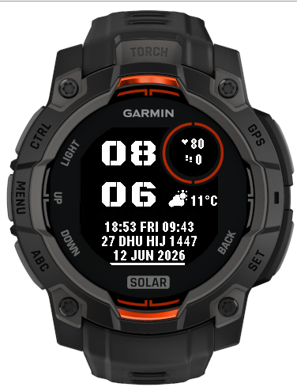

# My Watch Face for Garmin Instinct 3 Solar 45mm

A Connect IQ watch face for the **Garmin Instinct 3 Solar 45mm** with stacked Black Ops One time digits, sunrise/sunset row, dual-calendar dates, weather, and an activity porthole.

> **Note:** Source is intentionally monolithic in a single `MyWatchFace.mc` file for easy sharing and review.

## Layout

```
┌─────────────────────────────────────┐
│                         ╭─ ♥ 80 ─╮ │
│   HH                    │ 👣 1234 │ │
│   MM                    [☀] 12°C  │
│                                     │
│        06:00 FRI 18:00              │
│        15 DHU HIJ 1447              │
│        31 MAY 2026                  │
│▓▓▓▓▓▓▓▓▓▓▓▓░░░░░░░░░░░░░░░░░░░░░░░░░│ battery
└─────────────────────────────────────┘
```

## Features

### Time

- **Stacked 24 h** — `HH` over `MM` (no colon)
- **Black Ops One bitmap digits** — 10 per-digit 32×42 sprites (binarized for MIP)
- Positioned upper-left toward center

### Sun times & weekday

- **Sunrise / sunset / DOW row** — `06:00 FRI 18:00` in `FONT_XTINY`, centered just above the Hijri date
- Sunrise and sunset from `Weather.getSunrise()` / `Weather.getSunset()` (requires phone weather sync and location)
- Falls back to `--:-- FRI --:--` when sun times are unavailable

### Dates

- **Hijri** — `DD MONTHNAME YYYY` (e.g. `15 DHU HIJ 1447`)
- **Gregorian** — `DD MMM YYYY` (e.g. `31 MAY 2026`)
- **Hijri offset** — configurable ±2 days (Settings → Hijri date shift)
- **Color theme** — dark (default) or light background with matching text and bitmap ink

### Weather (under porthole)

- 24×24 **1-bit PNG sprites** (7 categories: clear, partly cloudy, cloudy, wind, rain, storm, snow) + temperature in °C
- Centered horizontally under the activity porthole, vertically between the porthole bottom and the sun/DOW row
- Hand-drawn pixel icons tuned for MIP readability; Garmin condition codes map to 7 buckets (fog → cloudy, wintry mix → snow, etc.)
- Refreshed at most every **15 minutes**

### Activity porthole (upper-right)

- **Heart rate** — heart icon + value (upper porthole)
- **Steps** — shoeprint icon + count (porthole vertical center)
- Updated on the same **once-per-minute** tick as the rest of the face

### Battery bar

- 4 px bar at the bottom, proportional fill

## Power efficiency

All UI updates run on a **single 60-second timer** — no sub-minute partial redraws.

| Mechanism | Detail |
|-----------|--------|
| Minute tick | `Timer` fires every 60 s; refreshes steps, HR, dates, weather cache, then full redraw |
| Cached weather | `Weather.getCurrentConditions()` at most every 15 min |
| Cached sun times | `Weather.getSunrise()` / `getSunset()` on the same tick when weather data is available |
| Cached battery | `System.getSystemStats()` at most every 5 min |
| No background service | No `Background` permission — no wake-ups when face is inactive |
| No partial updates | Full 176×176 redraw once per minute only |

## Modules

| Module | Purpose |
|--------|---------|
| `Theme` | `colorMode` property, palette colors, dark/light resource selection |
| `ClockDigits` | Black Ops One per-digit bitmap renderer for stacked time |
| `HijriHelpers` | Hijri calendar, weekday abbreviation, and date label helpers |
| `TimeHelpers` | Hour/minute formatting for stacked time and sun times |

Clock digit sprites (`digit_0.png` … `digit_9.png`, 32×42, plus `*_light.png` for light theme) regenerate via [`scripts/generate-clock-digits.ps1`](scripts/generate-clock-digits.ps1) using [Black Ops One](https://fonts.google.com/specimen/Black+Ops+One) (OFL).

Weather icons are 24×24 hand-drawn PNGs in [`resources/images/`](resources/images/) (regenerate via [`scripts/generate-weather-icons.ps1`](scripts/generate-weather-icons.ps1); each icon has a `_light` variant).

Porthole metric icons (`icon_heart.png` 10×10, `icon_steps.png` 12×12, plus `_light` variants) regenerate via [`scripts/generate-porthole-icons.ps1`](scripts/generate-porthole-icons.ps1).

## Settings

| Where | What |
|-------|------|
| On watch | Long-press **UP** → Customize → **Watch face settings** → Hijri date shift or Color theme |
| Garmin Connect / Express | App settings: Hijri date adjustment, Color theme (dark / light list) |

Default theme is **dark** (unchanged look for existing installs).

## Permissions

| Permission | Used for |
|------------|----------|
| `UserProfile` | User profile data |
| `positioning` | Weather location and sunrise/sunset |
| `SensorHistory` | Heart rate history fallback |

## Building

### Prerequisites

1. [Connect IQ SDK](https://developer.garmin.com/connect-iq/connect-iq-basics/getting-started/)
2. `developer_key.der` in the project root

### Build

```shell
monkeyc -o watchface.prg -d instinct3solar45mm -y developer_key.der -f monkey.jungle
```

### Simulator

```shell
connectiq
monkeydo watchface.prg instinct3solar45mm
```

## Installation

1. Connect the watch via USB
2. Copy `watchface.prg` to `GARMIN/APPS/`
3. Select the watch face in watch settings

## Screenshot


