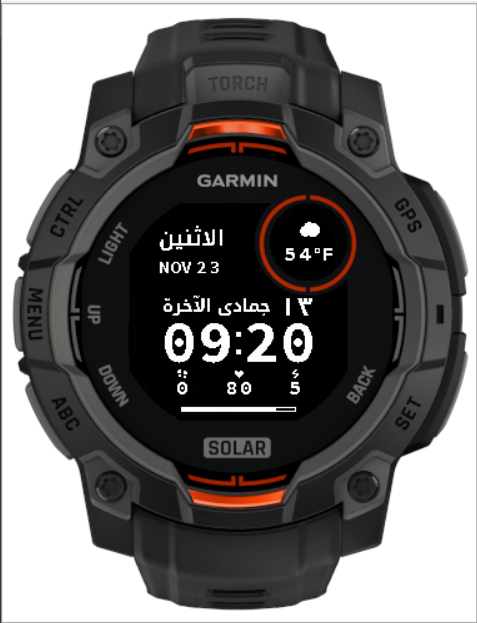

# My Watch Face for Garmin Instinct 3 Solar 45mm

An Arabic/English hybrid Connect IQ watch face for the **Garmin Instinct 3 Solar 45mm**: single-row Western `HH:MM` time, pure Arabic weekday and Hijri date (with Eastern-Arabic day numerals), English Gregorian date, temperature in `°C`/`°F` + 1-bit weather icon in the porthole, and Steps / Heart Rate / Body Battery on the bottom shelf.

> **Note:** Source is intentionally monolithic in a single `MyWatchFace.mc` file for easy sharing and review.

## Layout

```
┌─────────────────────────────────────┐
│  [Arabic Weekday]       ╭───────╮   │
│                         │ (cld) │   │
│  NOV 23                 │ 54°F  │   │
│                         ╰───────╯   │
│     [Arabic Hijri Month]  13        │
│                09:20                │
│     [steps]    [hr]      [bb]       │
│       0         80        5         │
│          [▓▓▓▓▓▓▓▓▓░░░]             │ battery
└─────────────────────────────────────┘
```

Header is Arabic weekday + English Gregorian (`MMM DD`) on the left, weather + temperature in the
porthole. Hijri (the long row, Arabic month + Eastern-Arabic day) is centred on the divider so it clears the
porthole. Time is a single-row `HH:MM` across the equator. The shelf shows Steps, Heart Rate, and Body Battery
with 1-bit icons above the battery gauge.

Date rows are month + day, day on the right.

The display is a 176×176 **semi-octagon**, not a circle — the corners are rounded
chamfers, so the usable span narrows sharply top and bottom. The top-right corner
is the hardware porthole, so that chamfer is not cut. The battery bar is inset to
the panel's actually-visible span rather than drawn edge to edge; drawn full width
it would be invisible below 22 % and saturated above 78 %.

## Features

### Time

- **Single-row 24 h** — `HH:MM` with a drawn colon (there is no colon sprite)
- **Source Code Pro Bold digits** — *tabular* `0–9` sprites, dark + light
- Centred on the wide equator (`27×34 px` cells)

### Weekday

- Full Arabic name, left-aligned in the header (`الأحد` … `السبت`)
- Sunrise/sunset are not shown

### Dates

- **Gregorian** — English 3-letter month (`JAN`…`DEC`) + Western day (`01`…`31`, no year) in header
- **Hijri** — full Arabic month name + Eastern-Arabic day (no year), centred on the divider
- **Hijri offset** — configurable ±2 days (Settings → Hijri date shift). Converted
  on every redraw so Connect / on-watch changes apply immediately

### Theme

- **Color theme** — dark (default) or light, rendered for the 1-bpp (black/white only) MIP display

### Temperature

- Western numerals + unit (`15°C` or `59°F` depending on device temperature units), centred in the porthole
- Rounded, not truncated: −0.6 °C reads `-1°C`
- Missing data draws `--°C` (or `--°F`)

### Activity porthole (upper-right)

- **Weather** (1-bit primitive: sun, cloud, rain, storm, snow) above **temperature**
- Geometry comes from `WatchUi.getSubscreen()`, not a hardcoded centre

### Bottom shelf

- **Steps** (left) — exact at every value; past 9999 the row drops to the `xs` tier
- **Heart rate** (centre) — bpm from activity history / live activity / sensor history; missing data draws `--`
- **Body battery** (right) — percent; missing data draws `--`
- **Battery bar** — 4 px gauge under the metrics (1 px outline track with proportional fill), inset to the visible span

## Power efficiency

All UI updates run on a **single 60-second timer**.

| Mechanism | Detail |
|-----------|--------|
| Minute tick | `Timer` every 60 s; refreshes steps, dates, weather cache, then full redraw |
| Cached weather | `Weather.getCurrentConditions()` at most every 15 min |
| Cached battery | `System.getSystemStats()` at most every 5 min |
| No background service | No `Background` permission |
| No partial updates | Full 176×176 redraw once per minute only |

## Modules

| Module | Purpose |
|--------|---------|
| `Theme` | `colorMode` property, palette, dark/light resource selection |
| `GlyphSet` | One tabular sprite tier: uniform digit cells, optional symbols |
| `Glyphs` | The four tiers, plus the inline-time helper |
| `ArabicLabels` | Current Hijri month, Gregorian month, and weekday bitmaps |
| `HijriHelpers` | Tabular Hijri conversion |
| `TimeHelpers` | Hour/minute formatting for inline time |

### Sprite tiers

Cell sizes are **derived** by the generator from the widest ink it actually renders,
never hardcoded, so changing the font or a target height stays correct.

| Tier | Cell | Used by |
|------|------|---------|
| `digit_` | 27×34 | Inline clock (`0–9`) |
| `sm_` | 14×17 | Hijri day (`٠–٩`) |
| `md_` | 11×13 | Steps (≤ 9999), HR, body battery, temperature (`-`, `°`, `C`, `F`) |
| `xs_` | 10×11 | Gregorian day (`0–9`), steps (≥ 10000) |

Sprites regenerate via [`scripts/generate-arabic-assets.ps1`](scripts/generate-arabic-assets.ps1) from [Noto Kufi Arabic Bold](https://fonts.google.com/noto/specimen/Noto+Kufi+Arabic) (OFL) and Source Code Pro Bold.

## Settings

| Where | What |
|-------|------|
| On watch | Long-press **UP** → Customize → **Watch face settings** → Hijri date shift or Color theme |
| Garmin Connect / Express | App settings: Hijri date adjustment, Color theme (dark / light) |

Settings menus stay **English**. Default theme is **dark**.

## Permissions

| Permission | Used for |
|------------|----------|
| `UserProfile` | User profile data |
| `positioning` | Weather location |
| `SensorHistory` | Body battery history |

## Building

### Prerequisites

1. [Connect IQ SDK](https://developer.garmin.com/connect-iq/connect-iq-basics/getting-started/)
2. `developer_key.der` in the project root

### Assets

```shell
powershell -ExecutionPolicy Bypass -File scripts/generate-arabic-assets.ps1
```

### Build

```shell
monkeyc -o watchface.prg -d instinct3solar45mm -y developer_key.der -f monkey.jungle
```

### Simulator

```shell
connectiq
monkeydo watchface.prg instinct3solar45mm
```

## Installation

1. Connect the watch via USB
2. Copy `watchface.prg` to `GARMIN/APPS/`
3. Select the watch face in watch settings

## Screenshot


